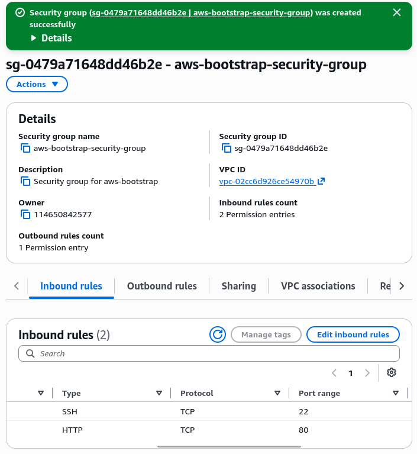
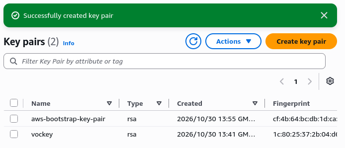
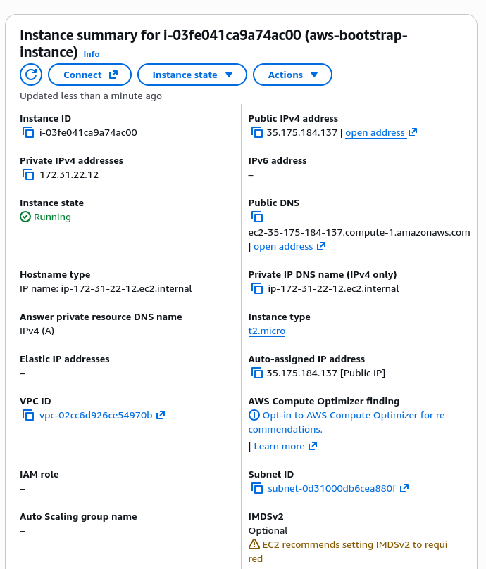
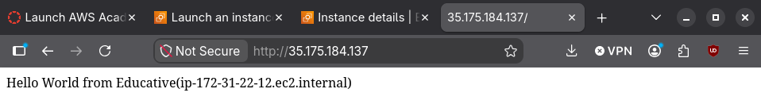
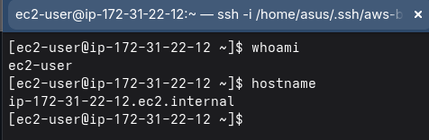
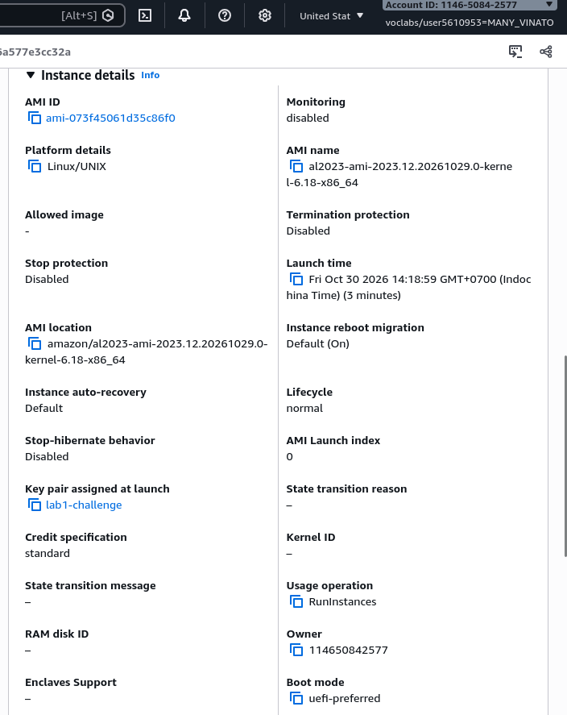
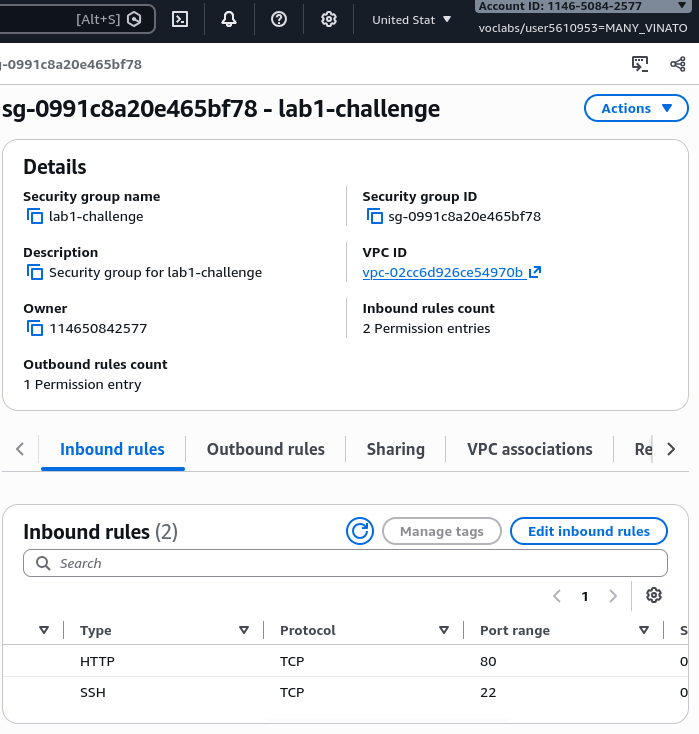
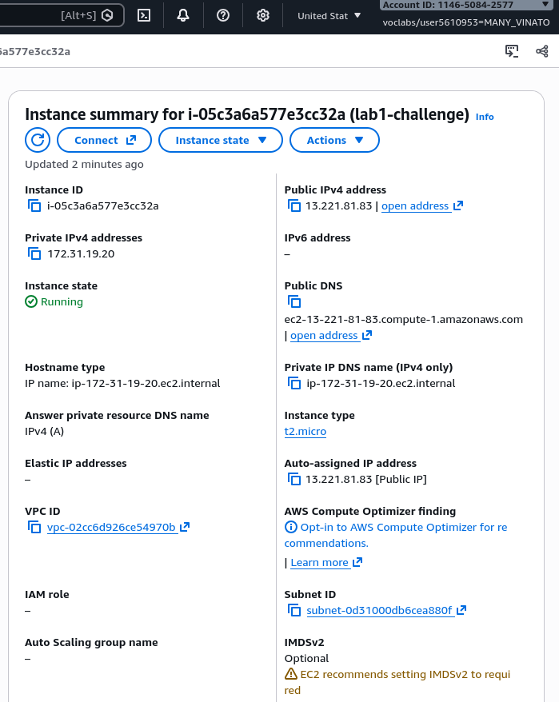
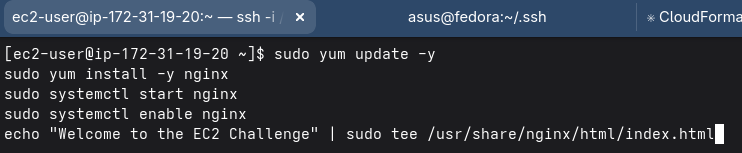
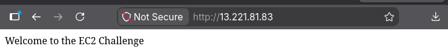

# Cloud Lab 1 Submission — Amazon EC2

Copy this template to `cc-lab-YOUR_ID/lab1/README.md` in your own repository. Follow [the instructions](lab1-instruction.md). Put your screenshots in `lab1/images/` with the file names below.

- **Student name:** MANY Vinato
- **Student ID:** e20210816
- **Learner Lab user name:** Vinato Many
- **Date completed:** 30 October 2026

---

## Part 1.1 — An Amazon EC2 Walkthrough

### Security group



### Key pair



### Instance details



### Browser test



### SSH connection



Did you connect with your own SSH client or with EC2 Instance Connect?
---
**Answer**: I connect with my own ssh client via private key.

## Part 1.2 — EC2 Web Solution (Challenge)

### Launch configuration



### Security group



### Running instance



### Commands on the instance



Paste the commands you ran to install the web server and create `index.html`:

```bash
sudo yum update -y
sudo yum install -y nginx
sudo systemctl start nginx
sudo systemctl enable nginx
echo "Welcome to the EC2 Challenge" | sudo tee /usr/share/nginx/html/index.html
```

### Browser test



---

## Questions

1. Your security group has an SSH rule and an HTTP rule. What does each one let you do? What would stop working if you deleted the HTTP rule?

    **Answer**: Each allow access to the port of SSH(port 22) to remote terminal access and HTTP(port 80) let browser load the web page. If u deleted the HTTP rule then the web page stop loading anymore only SSH still works. 

2. In Part 1.1 you never logged in to install the web server. What installed it, and when did it run?

    **Answer**: Script run at launch when entering command in the userdata section in dashboard. It's bootstrap so it ran once on first boot.

3. Why does the web page open with `http://` but not with `https://`?
   
    **Answer**: Because we only allow access to port 80 HTTP, HTTPS need port 443 plus we need an SSL certificate to use HTTPS.

4. Part 1.2 asked for a 10 GiB root volume. Where in the launch settings did you set it, and how can you check the size on the running instance?
   
    **Answer**: I set it in the instance details when launching instance. To check it, open the instance storage's tab in console or run 'lsblk' on the instance.

## Problems and how I solved them (optional)

## AI note (optional)

One suggestion an AI tool gave you and how you checked it.

## Clean up

- [x] Part 1.1: instance terminated, key pair and security group deleted.
- [x] Part 1.2: instance terminated, security group (and key pair, if any) deleted.
