# Cloud Lab 2 Submission — Load Balancer and Auto Scaling

Copy this template to `cc-lab-YOUR_ID/lab2/README.md` in your own repository. Follow [the instructions](lab2-instruction.md). Put your screenshots in `lab2/images/` with the file names below.

- **Student name:** MANY Vinato
- **Student ID:** e20210816
- **Learner Lab user name:** Vinato Many
- **Date completed:** 30 October 2026

---

## Security groups

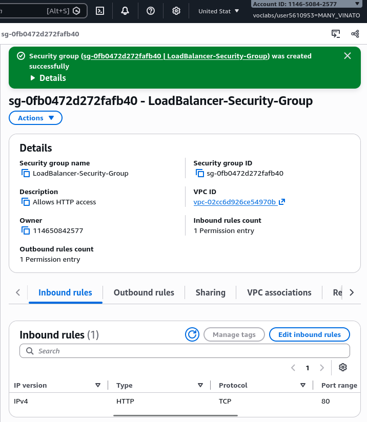

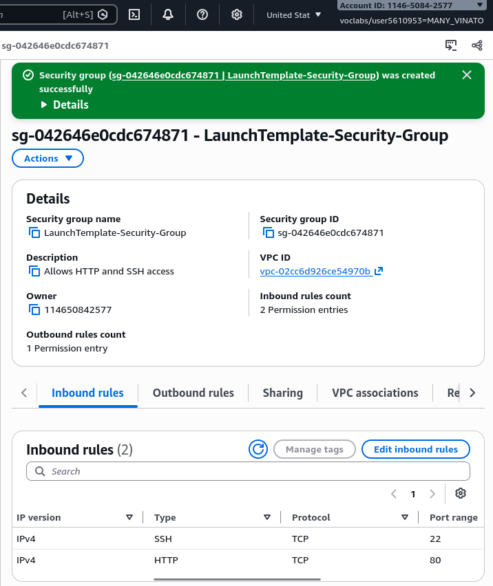

## Target group

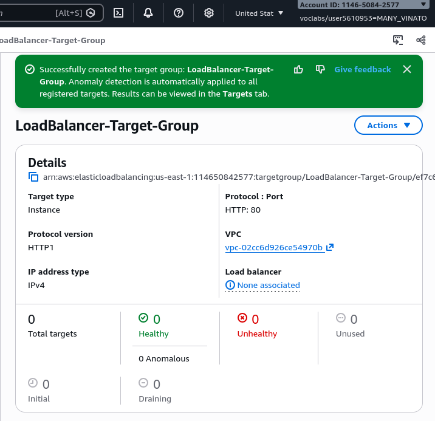

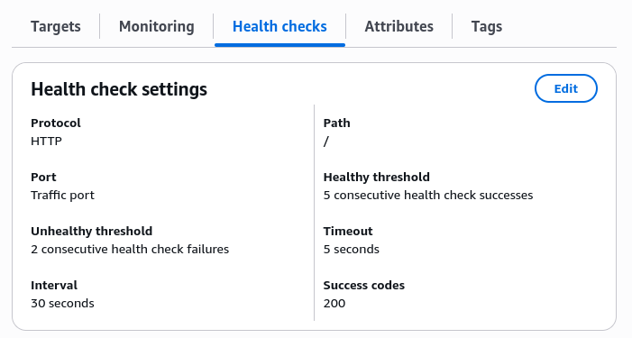

## Application Load Balancer

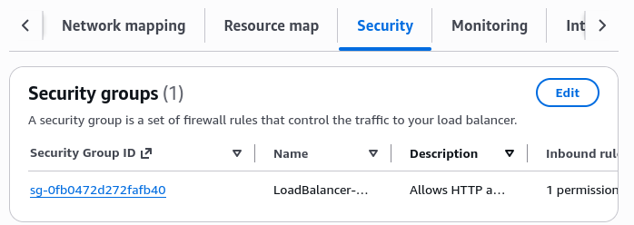

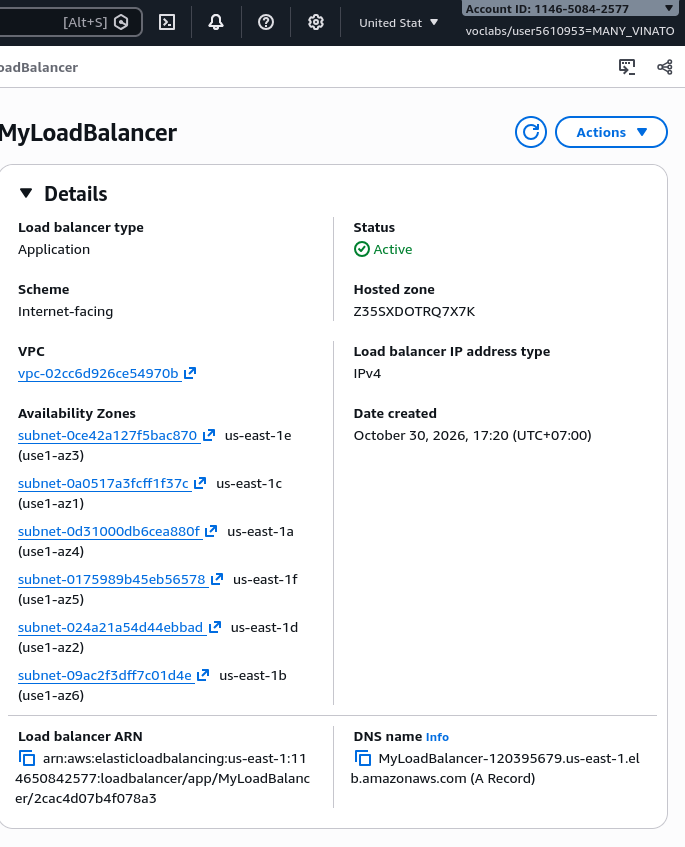

## Launch template

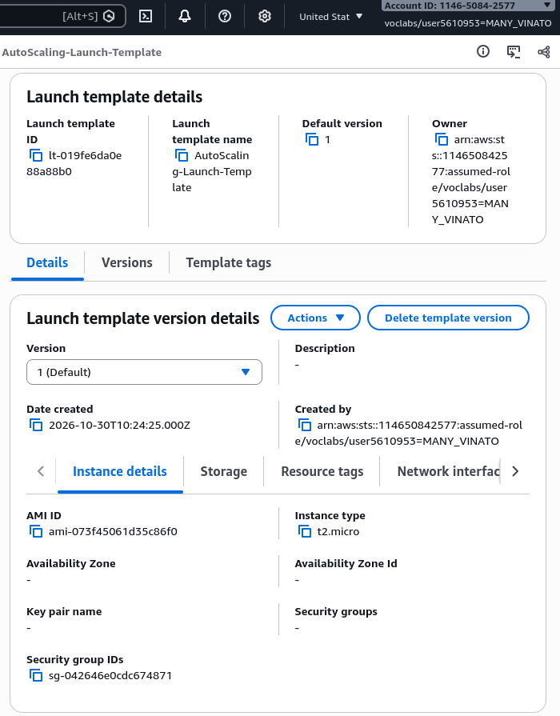

## Auto Scaling group

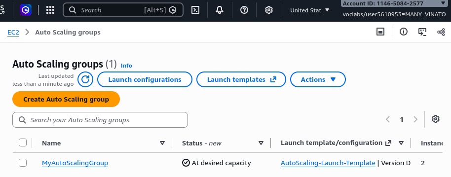

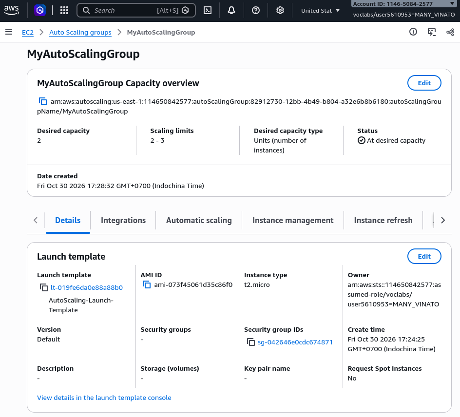

## Load balancing test

## Simulated application failure

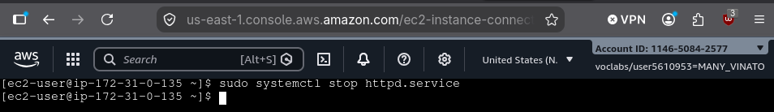

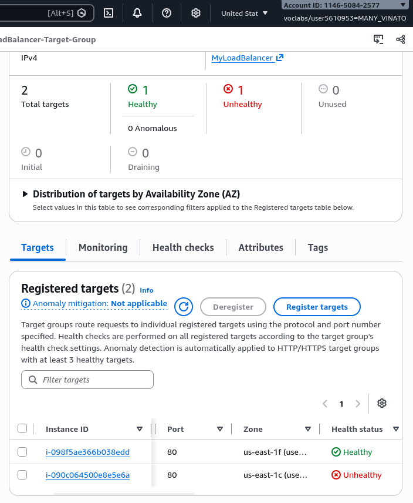

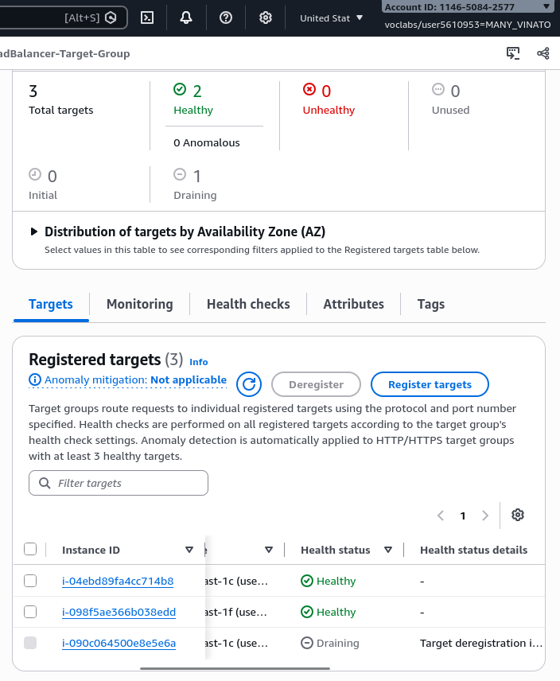

About how many minutes passed between stopping `httpd` and the new instance becoming healthy?

---
**Answer**: Around 6-10 minutes for the new instance becoming healthy.

## Questions

1. Why does the page show a different host name when you refresh it?

    **Answer**: load balancer spreads requests across the healthy instances in the target group. Each refresh alternate between instance.

2. After you stopped `httpd`, the instance was still *running* in EC2, but the target group marked it *unhealthy*. What did the health check test, and why did the instance fail it?

    **Answer**: target group sends an HTTP request to each instance and expects a success code such as 200. EC2 showed running because the server was still up, stopping httpd meant nothing was answering on port 80, making the checks failed and target marked unhealthy.

3. Who replaced the failed instance: the load balancer, the target group, or the Auto Scaling group? Explain the role of each one.

    **Answer**: Auto Scaling Group replaced it, it keeps the number of instances at the desired capacity, It terminates an unhealthy instance and launches a new one. Load balancer receives traffic from users and forward it only to healthy targets. Target group keeps the list of instances and run health checks.

4. With desired 2, minimum 2 and maximum 3, how many instances run normally? In what situation could there be 3?

    **Answer**: Desired 2 so normally, 2 instances run. There could be 3 if a policy adds an instance duringg high load. It could happen brieftly dudring an insntance refresh or a replacement.

5. The instances' security group allows HTTP from anywhere. How could you change it so that the instances accept HTTP **only** from the load balancer?

    **Answer**: Edit the instances security group and remove the HTTP inbound rule. Then add an HTTP(port 80) rule whose source is the load balancer's security group.

## Problems and how I solved them (optional)

## AI note (optional)

One suggestion an AI tool gave you and how you checked it.

## Clean up

- [x] `MyAutoScalingGroup` deleted and its instances terminated.
- [x] `AutoScalingLaunchTemplate` deleted.
- [x] `MyLoadBalancer` and `LoadBalancerTargetGroup` deleted.
- [x] Both security groups deleted.
