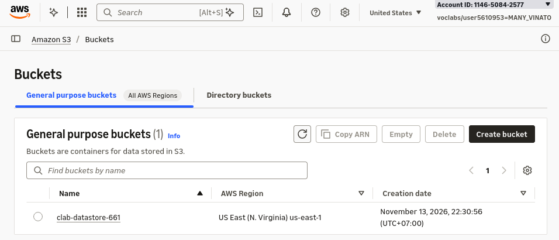
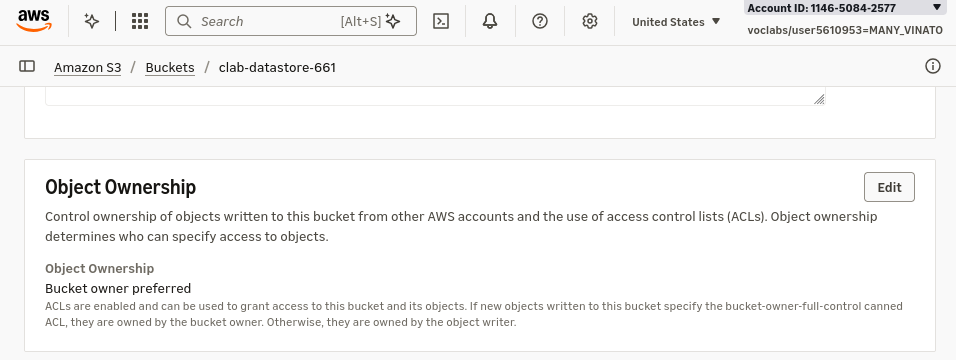
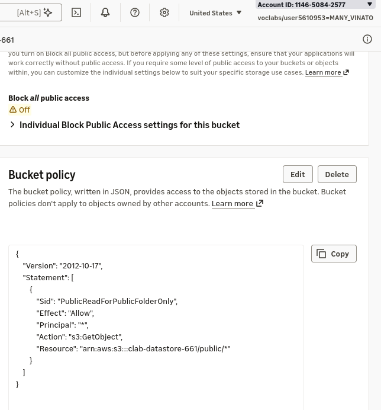
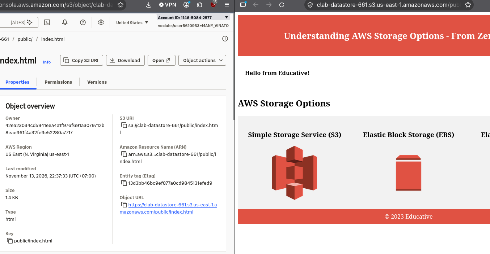
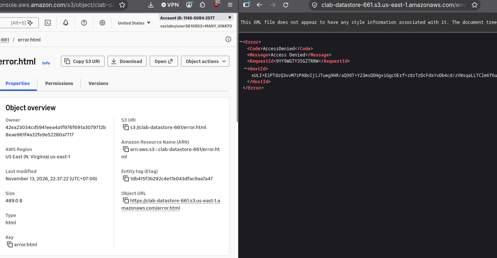
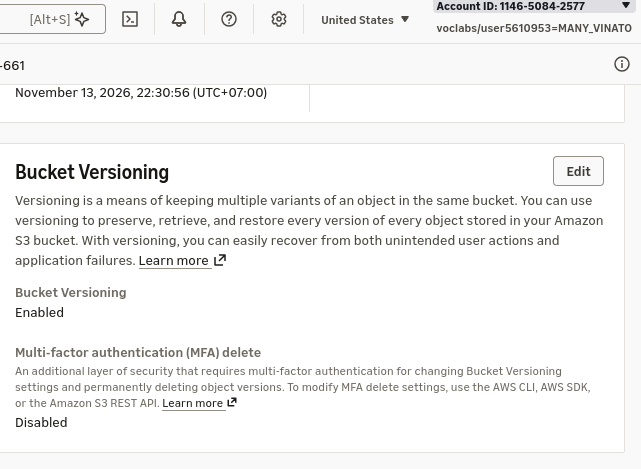
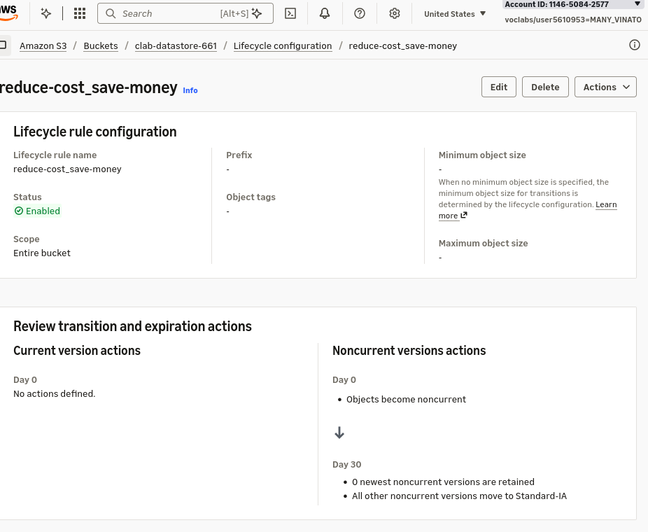

# Cloud Lab 3 Challenge Submission — Secure S3 Bucket

Copy this template to `cc-lab-YOUR_ID/lab3-challenge/README.md` in your own repository. Follow [the challenge](lab3-challenge.md). Put your screenshots in `lab3-challenge/images/` and your policy in `lab3-challenge/bucket-policy.json`.

- **Student name:** MANY Vinato
- **Student ID:** e20210816
- **Learner Lab user name:** MANY_VINATO
- **Bucket name:** clab-datastore-661
- **Date completed:** 13 November 2026

---

## 1. Bucket

## 2. Object ownership

## 3. Public access policy

My policy is in [bucket-policy.json](bucket-policy.json). Explain which line limits public access to the `public/` folder:

**Answer**: line 9 '"Resource": "arn:aws:s3:::clab-datastore-661/public/*"',
 The policy's "Principal": "*" (anyone) and "Action": "s3:GetObject" (read files) apply only to objects matching that path.

## 4. Versioning

## 5. Lifecycle rule

---

## Questions

1. You turned off parts of **Block Public Access** for this bucket. Why was that needed, and why is it still safe for the objects outside `public/`?

**Answer**: Block Public Access overrides any policy that would make the bucket public. It is still safe because s3 is private by default. Turning off Block Public Access only allows a policy to grant public access.

2. What is a **noncurrent version**? Give an example from your own test.

**Answer**: Noncurrent version is the older version of the current version that is stored in S3 after u made change to the current version. I upload index.html in public folder then edited it and uploaded it again with the same name. Second upoad became the current version and the first upload is now a noncurrent version.

3. Why move noncurrent versions to S3 Standard-IA instead of deleting them?

**Answer**: Because old verions are rarely accessed so it doesn't make sense to pay S3 standard pricee for them. And its better to keep the old versions as backup as if the changes can be made by mistake, u can restore them back.

## AI note (optional)

One suggestion an AI tool gave you and how you checked it.

## Clean up

- [x] All object versions deleted and the bucket deleted.
