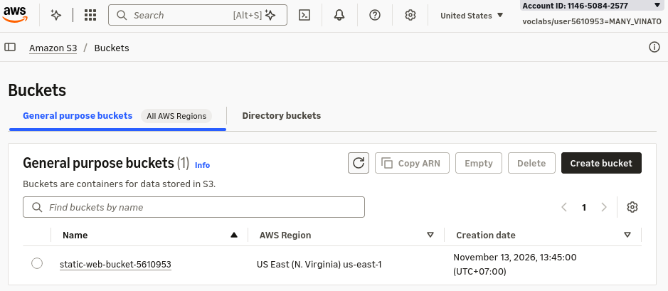
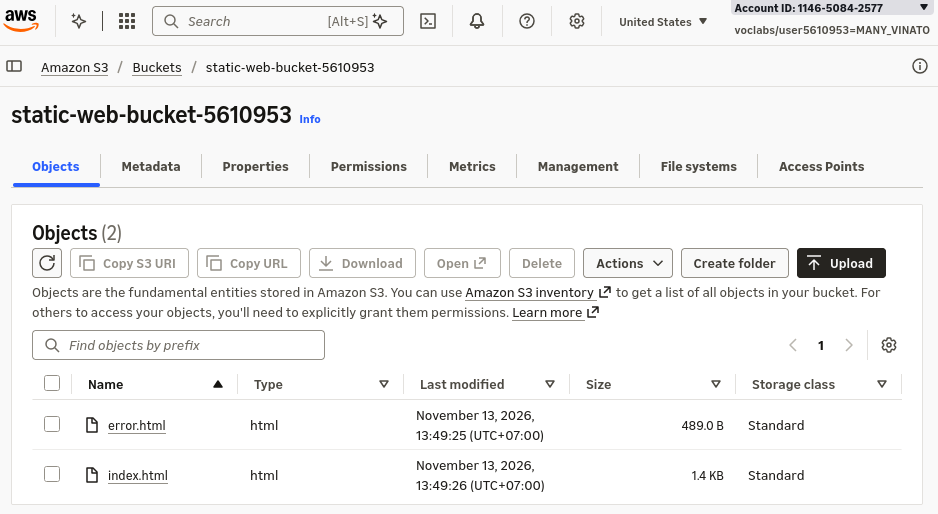
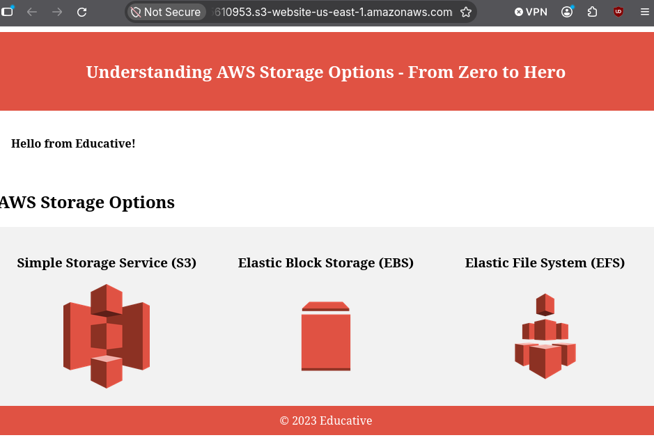
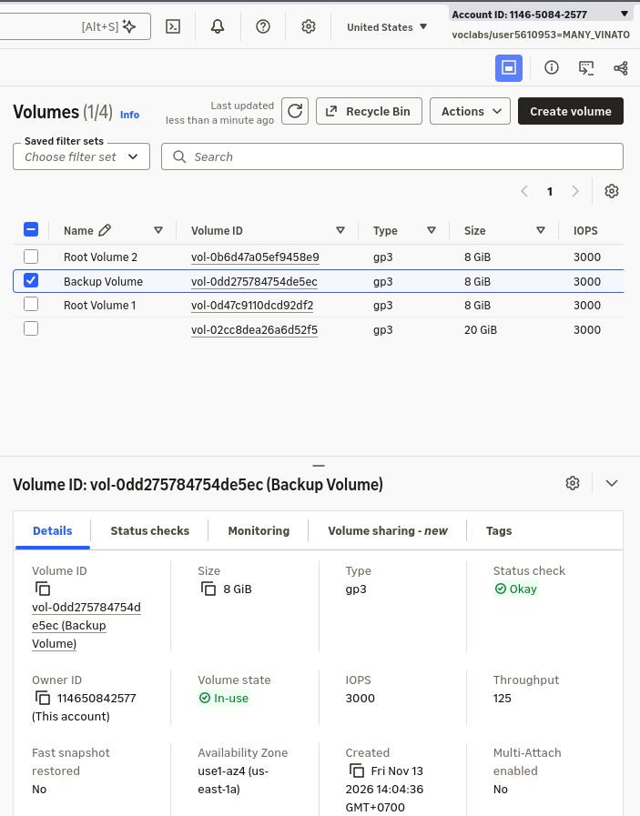
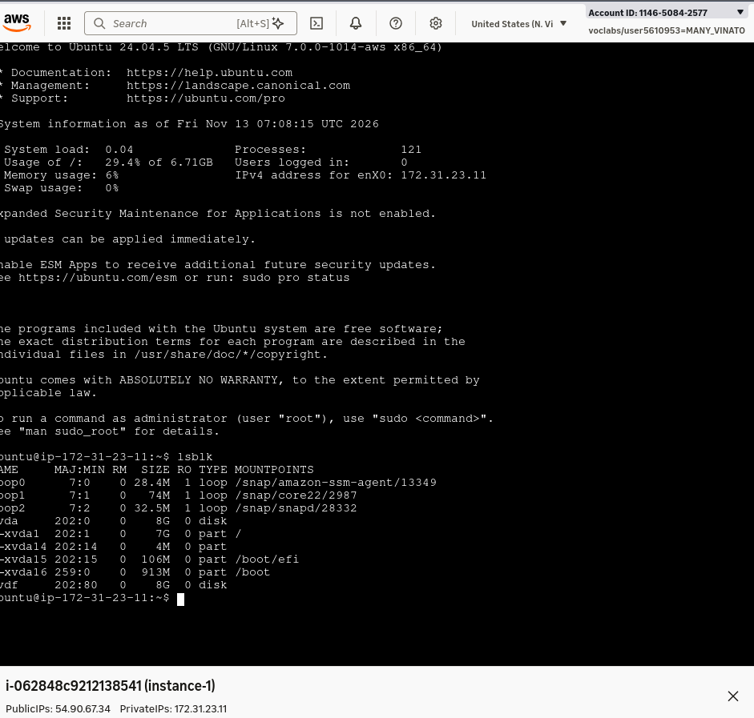
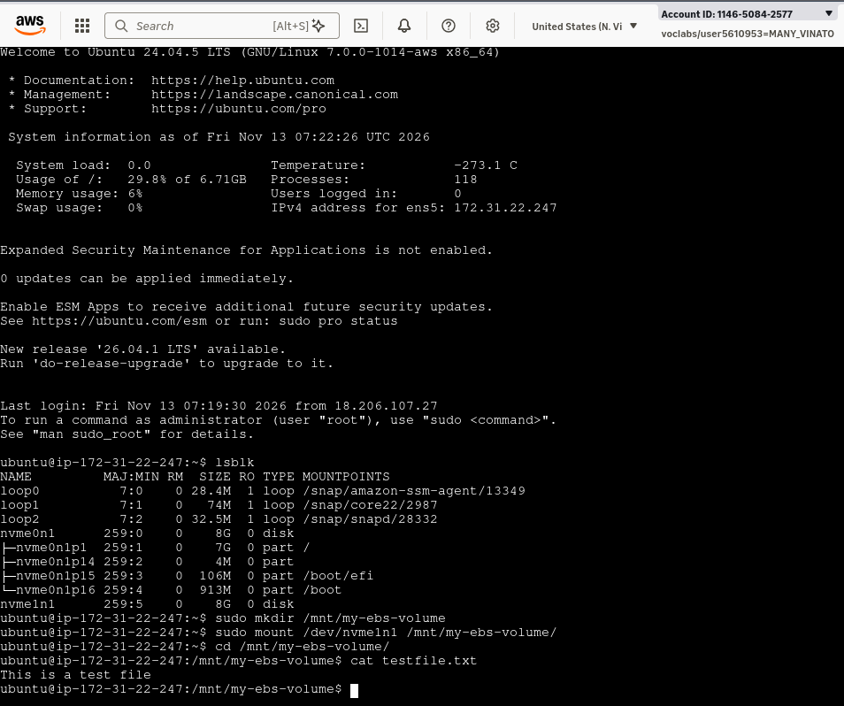
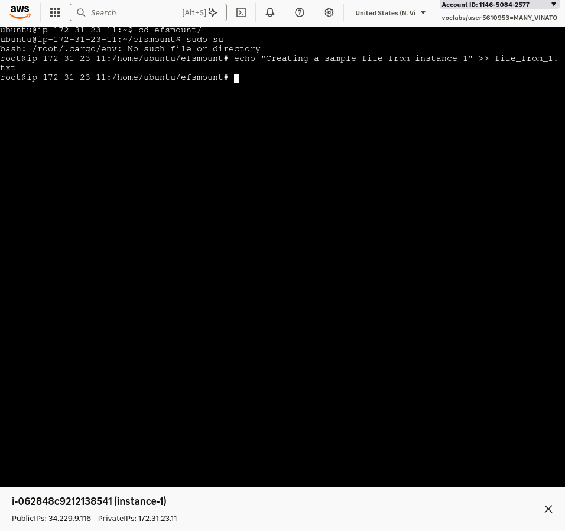
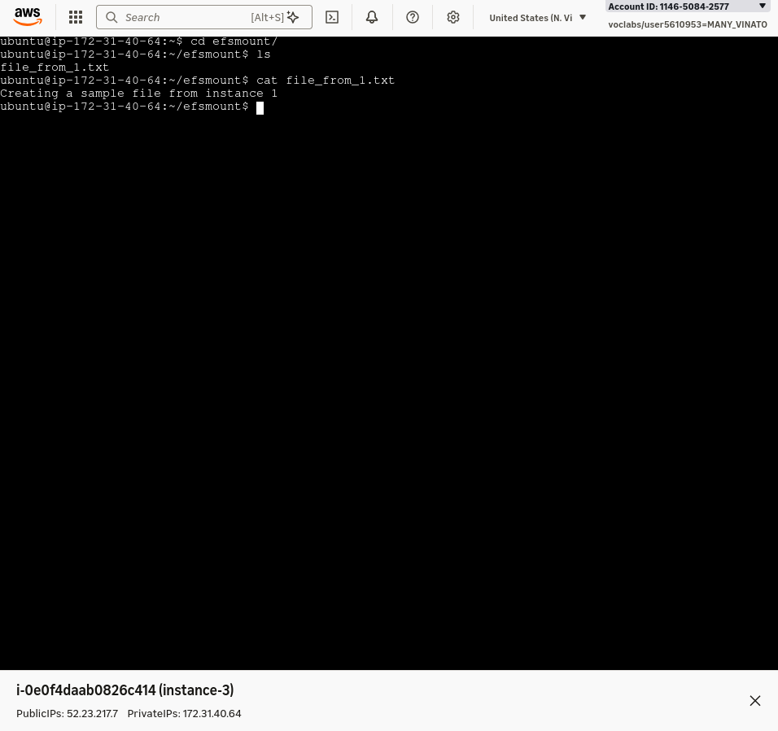

# Cloud Lab 3 Submission — AWS Storage Options

Copy this template to `cc-lab-YOUR_ID/lab3/README.md` in your own repository. Follow [the instructions](lab3-instruction.md). Put your screenshots in `lab3/images/` with the file names below.

- **Student name:** MANY Vinato
- **Student ID:** e20210816
- **Learner Lab user name:** MANY_VINATO
- **Date completed:** 13 November 2026

---

## Part 2.1 — Amazon S3

### Bucket list

### Uploaded files

### Static website

---

## Part 2.2 — Amazon EBS

### Volumes page

### Attached volume (`lsblk`)

Which device name did your volume get (`xvdf`, `nvme1n1`, ...)?
**Answer**: I got 'xvdf' in instance-1 since it use t2.medium and 'nvme1n1' in instance-2 & 3 since it use t3.medium.

### File read on instance-2

---

## Part 2.3 — Amazon EFS

### File system and mount targets

### File created on instance-1

### File listed on instance-3

---

## Questions

1. After you turned on static website hosting, the endpoint first answered **403 Forbidden**. Why, and what changed after you added the bucket policy?

**Answer**: Because S3 buckes and objects are private by default. Turning on static website hosting only gives the bucket a website endpoint. Bucket policy i added was allowing everyone the access to read the objects.

2. `testfile.txt` was still there after you moved **Backup Volume** to `instance-2`. What would have happened to a file saved on `instance-1`'s **root** volume after terminating `instance-1`?

**Answer**: The file would be lost. AWS deletes it when the instance is terminated, along with any file saved on it. Backup Volume was an extra volume attached separately so it wont be delete when u terminate instances.

3. Why did you run `mkfs` on `instance-1` but not on `instance-2`?

**Answer**: Because new EBS volume was blank. It has no file system, and Linux can't mount or store files on a volume until a file system exists, so **mkfs** created one.

4. Why could `instance-1` and `instance-3` use the EFS file system at the same time, when an EBS volume had to be detached first? Why did they have to be in the subnets of the mount targets?

**Answer**: EBS is a block storage that attaches to one instance at a time. It also lives in a single Availability Zone, so it had to be detached before attaching it elsewhere. Instances reach EFS through mount targets. The EFS DNS name points each instance to the mount target in its own Availability Zone. The mount target's security group also has to allow NFS traffic on port 2049.

5. For each need, choose S3, EBS or EFS and give one reason: (a) a website's images, (b) the disk of a database server, (c) a folder shared by several web servers.

**Answer**: (a). S3. can store unlimited data and can serve files directly over HTTP. (b). EBS. low latency block storage with steady IOPS, attached directly to the server running the database. (c). EFS. Many instances can mount the same file system and use it at the same time.

## Problems and how I solved them (optional)

## AI note (optional)

One suggestion an AI tool gave you and how you checked it.

## Clean up

- [x] Instances `instance-1`, `instance-2`, `instance-3` terminated.
- [x] `clab-efs` and **Backup Volume** deleted.
- [x] Security groups `efs-sg` and `ec2instances-sg` deleted.
- [x] S3 bucket emptied and deleted.
