# Cloud Lab 4 Submission — Amazon VPC

Copy this template to `cc-lab-YOUR_ID/lab4/README.md` in your own repository. Follow [the instructions](lab4-instruction.md). Put your screenshots in `lab4/images/` with the file names below.

- **Student name:** MANY Vinato
- **Student ID:** e20210816
- **Learner Lab user name:** MANY_VINATO
- **Date completed:** 06 November 2026

---

## VPC and internet gateway

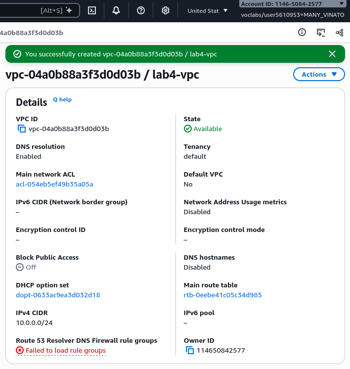

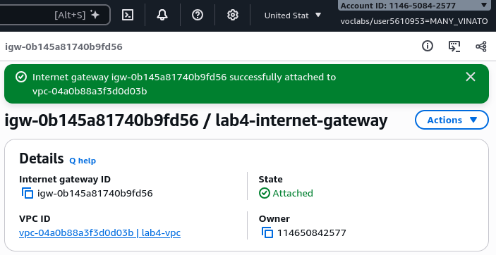

## Public subnet

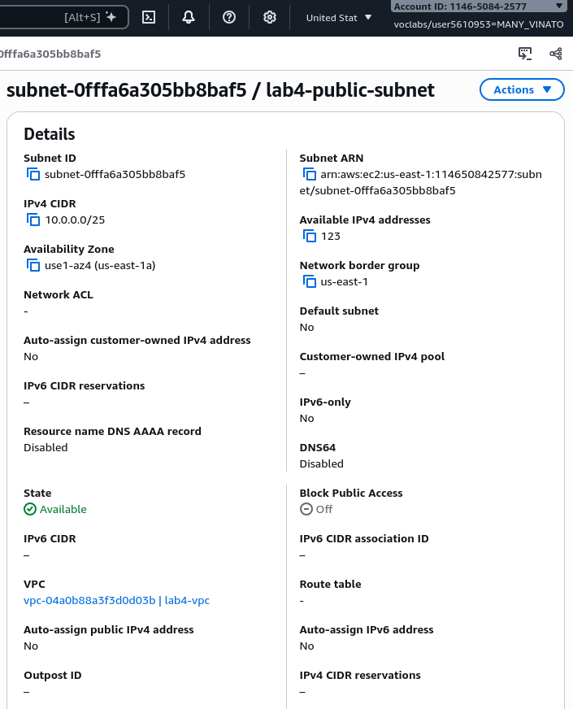

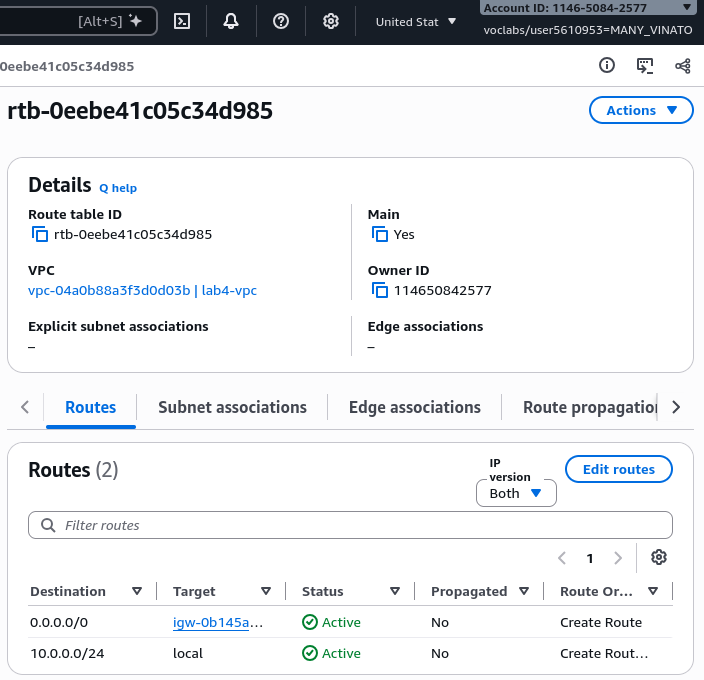

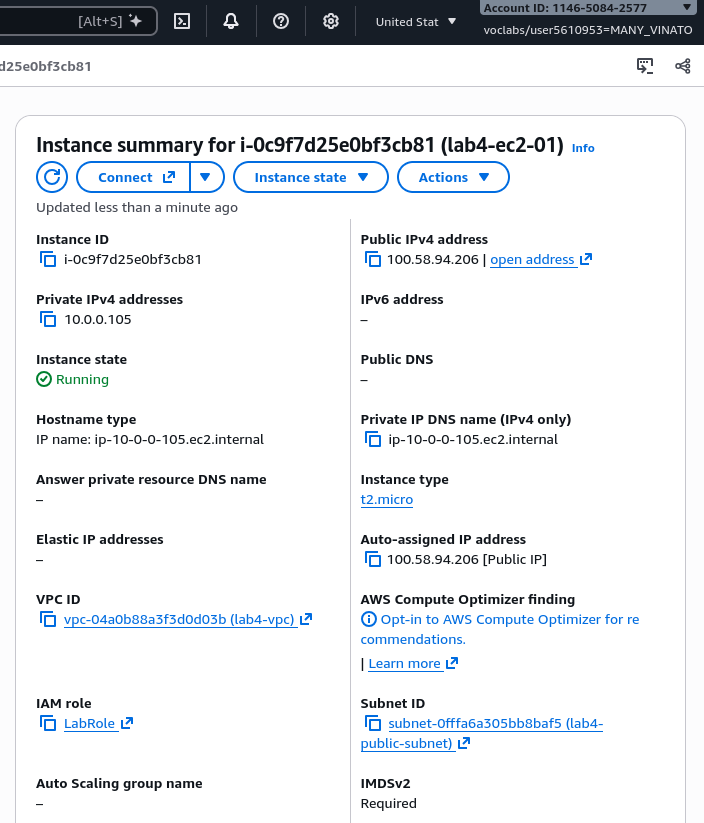

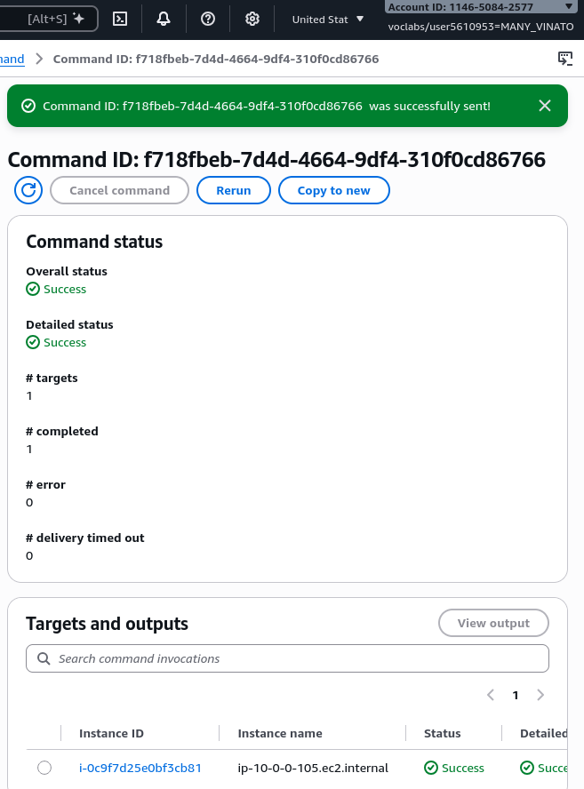

## Private subnet

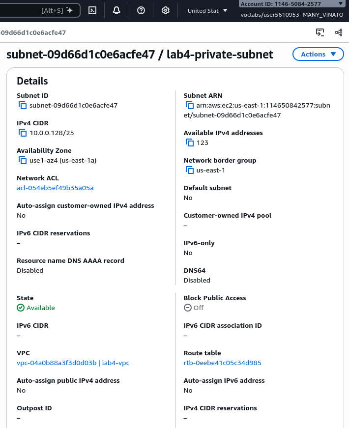

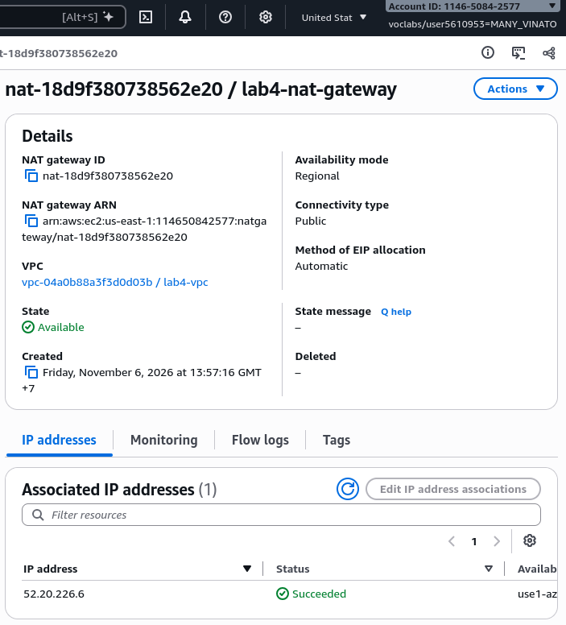

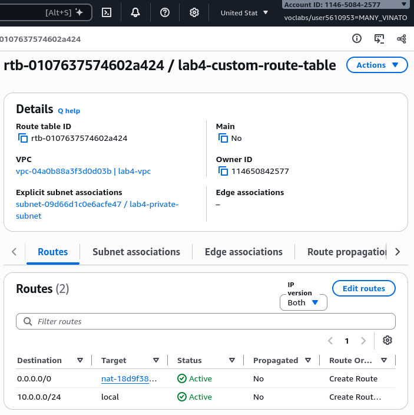

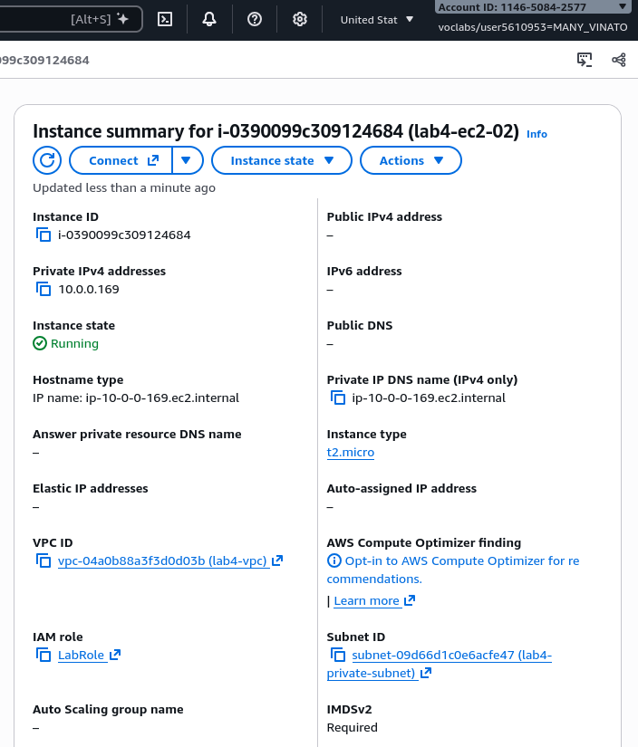

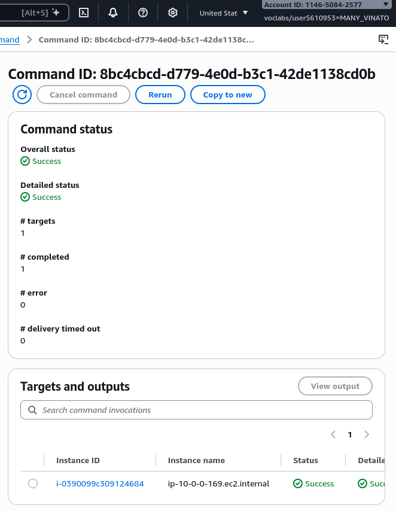

---

## Questions

1. The VPC is `10.0.0.0/24` and the subnets are `10.0.0.0/25` and `10.0.0.128/25`. How many IP addresses does each block contain, and why do the two subnets not overlap?

**Answer**: Each /24 block contains 256 IPs and /25 block contains 128 IPs. 2 subnet of /25 does not overlap because the 10.0.0.0/25 runs from 10.0.0.0 to 10.0.0.127 while the 10.0.0.128/25 runs from 10.0.0.128 to 10.0.0.255.

2. Both subnets are in the same VPC. What exactly makes `lab4-public-subnet` public and `lab4-private-subnet` private?

**Answer**: Public subnet route table has a 0.0.0.0/0 route to internet gateway while private subnet route table has no route to internet gateway. 

3. Why is the NAT gateway placed in the **public** subnet and not in the private one?

**Answer**: NAT gateway are placed inside the public subnet because it needs its own route to the internet gateway to forward to the private subnet.

4. `lab4-ec2-02` has no public IP address. Can someone on the internet open a connection to it? Can it download updates? Explain both answers.

**Answer**: No. But it can download updates. ec2-02 has no inbound rule so it does not have a public IP and its subnet has no route to the internet gateway. However, it does has outbound rule because the route table sends 0.0.0.0/0 to the NAT gateway which forward the traffic to the internet using elastic IP.

5. You tested internet access with Systems Manager instead of SSH. Why did the instances need `LabInstanceProfile` for this?

**Answer**: LabInstanceProfile gives the instance an IAM role. Thee role lets the instance talk to SSM. Can't use SSH because there is no public IP and no route from the internet.

## Problems and how I solved them (optional)

## AI note (optional)

One suggestion an AI tool gave you and how you checked it.

## Clean up

- [x] Instances terminated.
- [x] NAT gateway deleted and its Elastic IP released.
- [x] Internet gateway detached and deleted.
- [x] `lab4-vpc` deleted.
